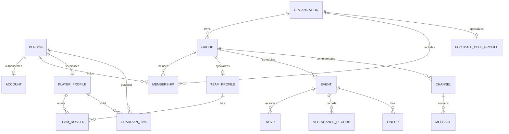

# Data model and ownership contract

**Status:** conceptual model for implementation, *not yet SQL migrations*. Database schema is owned by its domain module; these names illustrate consistent boundaries.

## Core aggregates

| Concept | Meaning and key invariants |
|---|---|
| `person` | real human identity distinct from login/account |
| `account` | one login mapped to person, can span organizations |
| `organization` | tenant boundary; never football-specific |
| `group` | named subset of organization (teams are mapped to groups) |
| `membership` | person belongs to organization/group with effective dates/status |
| `role_grant` | actor role in precisely defined organization/group context |
| `event_series` / `event` | recurrence with occurrence exceptions and timezone |
| `rsvp` | one eligible subject's intent per event; `unknown` != `no` |
| `channel` / `message` | authorized member set, append-order, edits/audit |
| `notification` / `subscription` | per-account preferences and push endpoint lifecycle |
| `media_asset` / `media_grant` | private asset with scoped download permissions |
| `audit_event` | privileged mutation trace, privacy-safe logging |
| `outbox_event` / `job` | durable, at-least-once asynchronous work |

## Football aggregates

| Concept | Meaning and key invariants |
|---|---|
| `football_club_profile` | typed details for a Core organization; no second club identity |
| `season` | dated competition period; club-specific or shared policy |
| `team_profile` | typed details for a Core group plus season/age rules |
| `player_profile` | football fields linked to Core person |
| `team_roster` | player membership for one team and effective period |
| `guardian_link` | verified adult-child relationship and **specific capabilities** |
| `guardian_verification` | verification state/audit, no name-based auto-link |
| `attendance_record` | actual attendance at a Core event |
| `match_roster` | selection of eligible players for a Core match event |
| `lineup` / `lineup_position` | versioned draft/published positioning data |
| `football_member_fields` | sport/club-specific admin attributes |
| `photo_consent` | audience/purpose-specific consent for child photo publishing |

## Relation diagram

## Invariants to encode in constraints and tests

- Tenant-scoped foreign keys/queries; no cross-club foreign memberships without explicit approved business rule.
- A guardian's right to respond for a child depends on *verified link + present validity + target team/event relationship + granted capabilities*.
- RSVP and attendance are separate, and no RSVP outcome alone proves attendance.
- Player/roster data is time-scoped; prior seasons remain auditable while permissions may change.
- Message access requires current channel rights, including pagination and event-stream replay.
- Stored media never becomes public merely by being linked in a team album.
- Personal information is not copied into generic audit payloads or push content by default.

## Data management

All storage uses parametrized statements and transactions via data-owning Racket modules. Organize migrations by module, with unique migration IDs, idempotent rollout checks and restore plans. Do not mix Core and Football table ownership. SQLite WAL supports many readers but a single concurrent writer; benchmark and control write transactions. Never use live personal data in fixtures.
